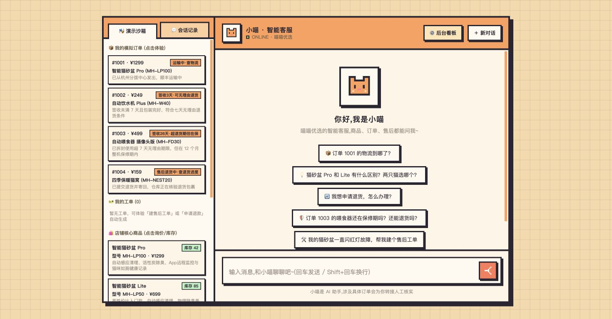
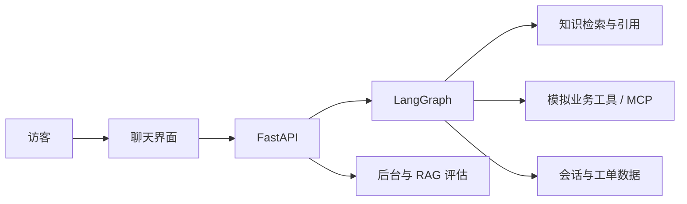

# MewHelp · 小喵智能客服

面向电商场景的 AI 客服演示项目。它将商品与售后知识检索、订单与物流模拟查询、工单确认流程放进同一套对话界面，并提供知识库、数据飞轮和 RAG 评估后台。

**[在线体验](https://mewhelp.mopfling.me/)** · [RAG 评估页面](https://mewhelp.mopfling.me/rag-eval)



> 在线站点使用模拟商品、订单和物流数据，供交互体验与技术展示；它不连接真实电商订单，也不处理真实支付。具体订单售后应由人工核实。

## 可以体验什么

| 场景 | 示例 |
| --- | --- |
| 商品咨询 | 比较猫砂盆 Pro 与 Lite 的功能，查询演示商品的价格与库存 |
| 知识问答 | 检索商品规格、配送与售后规则，回答中展示证据引用 |
| 模拟业务工具 | 查询演示订单物流、退货进度与工单状态 |
| 售后流程 | 识别退款、故障和人工跟进诉求，在提交前展示确认步骤 |
| 运营后台 | 查看知识库、低置信度问题、主题聚类和四策略 RAG 评估 |

## 技术实现

`FastAPI` 提供流式聊天与后台 API；`LangGraph` 负责意图分流、工具调用和售后流程；`Milvus Lite` 或 `Milvus Standalone` 负责知识检索；`SQLite` 或 `MySQL` 保存会话与知识条目。聊天、嵌入和重排模型分别通过环境变量配置。



## 本地运行

需要 Python 3.12+、[uv](https://docs.astral.sh/uv/) 和可用的聊天、嵌入、重排模型 API。轻量模式使用 SQLite 与本地检索，无需先启动数据库容器。

```bash
uv sync
cp .env.example .env
# 编辑 .env，填写 CHAT_BASE_URL、CHAT_MODEL、CHAT_API_KEY、EMBED_API_KEY、RERANK_API_KEY
bash scripts/start_lite.sh
```

首次启动会创建本地数据库并将 `data/kb/` 中的演示材料入库。访问 <http://localhost:8000/>。也可以使用 `docker compose -f docker-compose.lite.yml up -d --build` 启动轻量容器。

运行测试：`uv run pytest -q`。四策略检索与生成评估：`make eval-rag`，这会调用已配置的模型 API 并产生调用费用。

## 安全与边界

- `.env`、数据库、日志、缓存、模型和评估运行产物不纳入仓库；`.env.example` 只保留占位值。不要在 issue、截图或提交中粘贴真实密钥。
- 演示订单、库存、物流与工单是模拟数据。仓库中的测试结果或页面指标不代表真实电商业务表现。
- `docker-compose.yml` 与 `docker-compose.langfuse.yml` 包含仅供本地实验的默认账号和密码。公网部署前必须改为私有强凭据、限制管理入口，并检查安全配置。

项目基于《AI Agent 智能客服实战》课程实践继续改造，源码中的原始来源标注予以保留。
